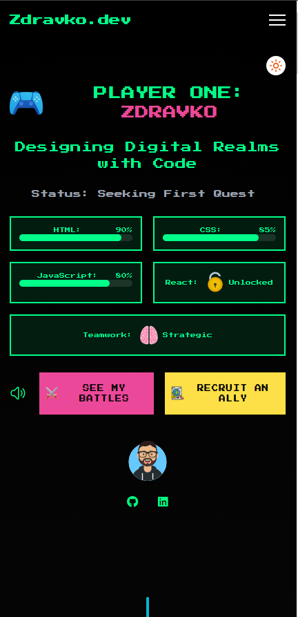
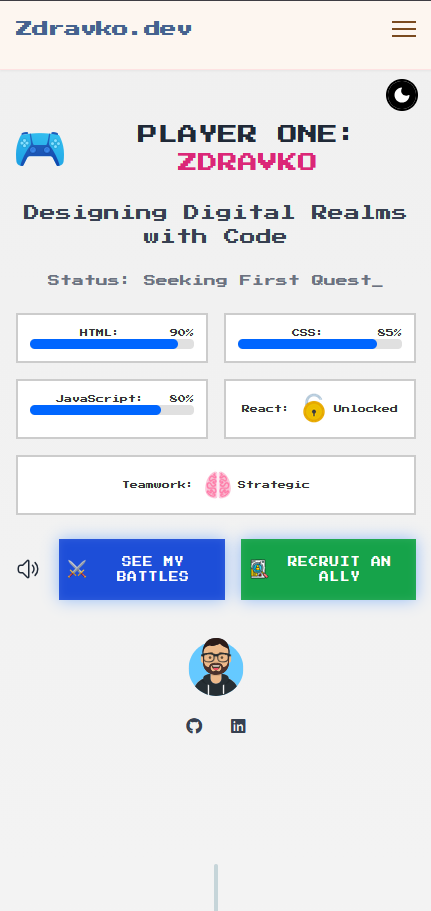
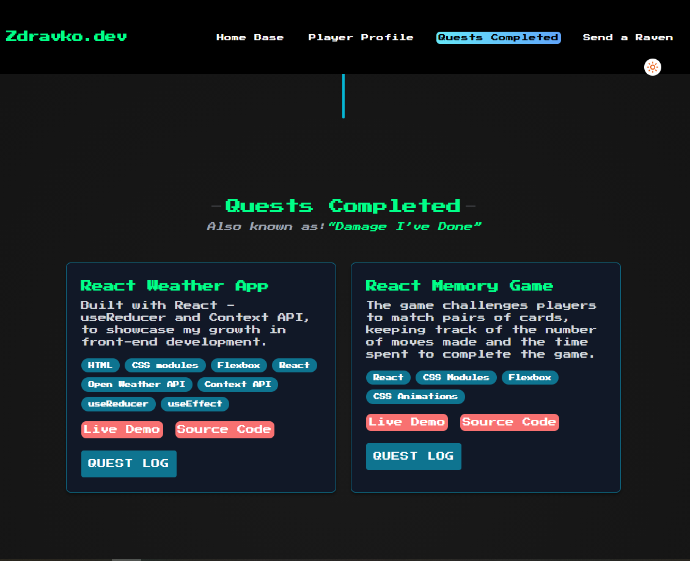
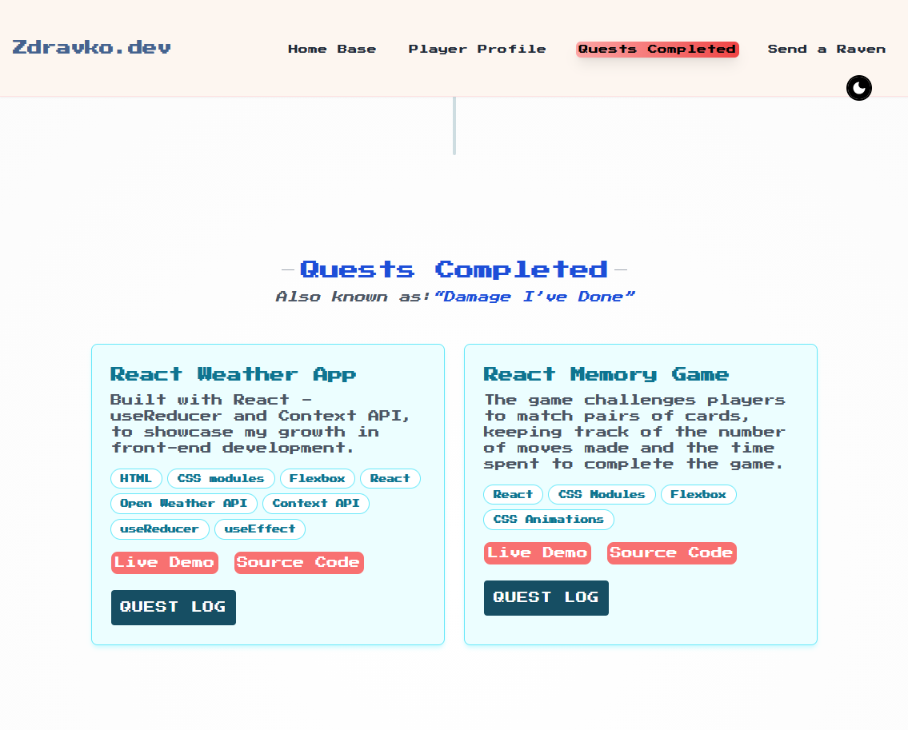

# React Portfolio

A personal portfolio website built with React to showcase my projects, skills, and experience. Designed to be responsive, intuitive, and visually engaging, it provides an onverview of my work and a way to get in touch.

---

## 📌 Table of Contents
- [Live Demo](#-live-demo)
- [Branches Overview](#-branches-overview)
- [Screenshots](#-screenshots)
- [Features](#-features)
- [Technologies Used](#-technologies-used)
- [Installation & Local Setup](#-installation--local-setup)
- [Deployment](#-deployment)
- [Contact](#-contact)

---

## 🌐 Live Demo

Check out the live website:

[React Portfolio Live Demo](https://Zdravko93.github.io/react_portfolio)

**Note:** The project has also been migrated to TypeScript. See the `migration/react-to-typescript` branch for the TypeScript version as a code reference.

## 📂 Branches Overview

- **master** - Original React implementation (live deployment)
- **migration/react-to-typescript** - Fully migrated TypeScript version, maintained as a code reference demonstrating improved type safety.

---

## 📸 Screenshots






---

## ⚡ Features

- Fully responsive layout for mobile, tablet, and desktop devices
- Projects showcase with descriptions and live links
- Skills section highlighting technologies and development experience
- Contact form for direct inquiries
- Dark and light themes
- Built with modern React development practices

---

## 🛠️ Technologies Used

- React
- JavaScript (ES6+)
- TypeScript (migration branch)
- HTML5
- Tailwind CSS
- Git & GitHub
- GitHub Pages (deployment)

---

## 💻 Installation & Local Setup

If you want to run this project locally, follow these steps:

### React Version (main branch)
```bash
git checkout master
npm install
npm start
```
### TypeScript Version (migration branch)
```bash
git checkout migration/react-to-typescript
npm install
npm start
```

## 🚀 Deployment

The React version is deployed using **GitHub Pages**:

```bash
npm run build
npm run deploy
```

**Note:** The live demo uses the React (master) branch. The TypeScript migration branch is maintained for code reference and local review.


#### 📫 Contact

Created by **Zdravko93**.

Feel free to connect:

- LinkedIn: [https://www.linkedin.com/in/zdravkodelic/](https://www.linkedin.com/in/zdravkodelic/)
- Frontend Mentor: [https://www.frontendmentor.io/profile/Zdravko93](https://www.frontendmentor.io/profile/Zdravko93)
- GitHub: [https://github.com/Zdravko93](https://github.com/Zdravko93)

⭐ If you like this project, consider giving it a star!
